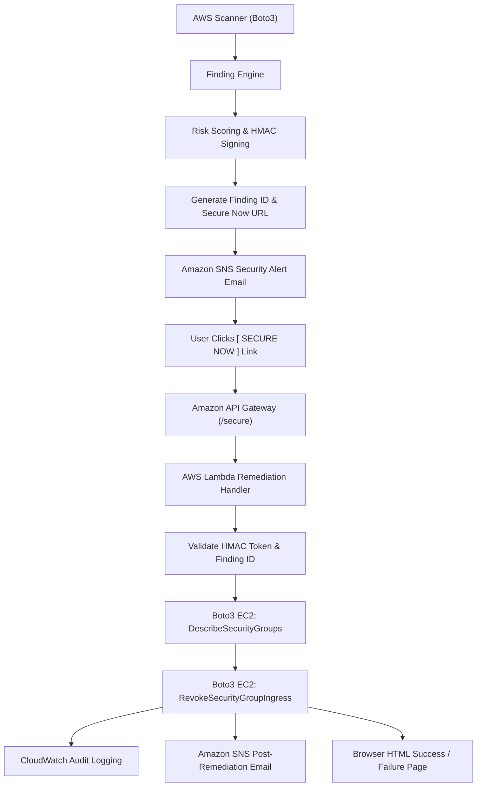

# 💎 CloudNet Sentinel

**CloudNet Sentinel** is an agentic, DevSecOps cloud security posture management (CSPM) platform that models AWS infrastructure as a directed graph to detect multi-step attack paths, prioritize risks using security and financial impact intelligence, and provide **cryptographically verified one-click automated remediation ("Secure Now")**.

---

## 🚀 Key Capabilities

- **Graph-Based Attack Path Analysis**: Uses `NetworkX` to map relationships across EC2, Security Groups, Subnets, VPCs, IAM roles, and S3 buckets.
- **Granular Security Findings**: Identifies exact vulnerable ingress rules, protocols, ports, and CIDR blocks.
- **Automated Security Alert Email**: Dispatches rich HTML and plain-text alert emails via **Amazon SNS** with technical risk explanations and a prominent **[ SECURE NOW ]** CTA button.
- **Cryptographically Signed Remediation**: Every "Secure Now" link contains an HMAC-SHA256 signed tamper-proof token encoding the authorized remediation action and expiration window.
- **Serverless AWS Remediation Engine**: **Amazon API Gateway** routes incoming requests to an **AWS Lambda function** that verifies token integrity, validates resource formats, and uses Boto3 EC2 APIs to safely revoke *only* the specific vulnerable rule.
- **Idempotent & Safe Execution**: Returns "Already Secured" if the rule was previously closed. Rejects arbitrary commands or unauthorized resource modifications.
- **CloudWatch Audit Trail**: Logs structured JSON audit records to CloudWatch Logs for full SIEM compliance.
- **Dual Interface**: Interactive Flask web dashboard (`http://localhost:5001`) and automated CLI (`main.py`).

---

## 🏗️ Architecture



```
                                CloudNet Sentinel Scan
                                          ↓
                              Detect Exposed Port & Ingress
                                          ↓
                                Calculate Risk Score
                                          ↓
                           Generate Security Finding & Token
                                          ↓
                             Send Amazon SNS Alert Email
                                          ↓
                        Email contains [ SECURE NOW ] Button
                                          ↓
                       User Clicks Link (or API Trigger)
                                          ↓
                             Amazon API Gateway (/secure)
                                          ↓
                           AWS Lambda Remediation Function
                                          ↓
                     Validate HMAC Signature & Rule Parameters
                                          ↓
                            Boto3 EC2: Describe & Verify
                                          ↓
                    Boto3 EC2: revoke_security_group_ingress
                                          ↓
                          Amazon CloudWatch Logs Audit Trail
                                          ↓
                     User Confirmation (HTML Page / JSON Response)
```

---

## 📂 Project Structure

```
cloudnet-sentinel/
├── app.py                      # Flask Web Dashboard & Local Remediation Proxy
├── main.py                     # CLI Scanner & Alert Dispatcher
├── requirements.txt            # Dependencies (boto3, flask, networkx, etc.)
│
├── scanner/                    # Resource Discovery Layer
│   ├── ec2_scanner.py          # Discovers instances, public IPs, attached SGs
│   ├── sg_scanner.py           # Ingress rule extraction (ports, protocols, CIDRs)
│   ├── iam_scanner.py          # IAM privilege & AdministratorAccess detection
│   ├── s3_scanner.py           # S3 Public Access Block auditing
│   └── aws_scanner.py          # Unified scanner suite
│
├── engine/                     # Analysis & Intelligence Engine
│   ├── finding_engine.py       # Finding generation, risk scoring, HMAC token signing
│   ├── graph_engine.py         # NetworkX DiGraph builder
│   ├── attack_path_engine.py   # Multi-hop attack chain traversal
│   ├── risk_engine.py          # Risk score calculation & severity derivation
│   ├── cost_engine.py          # Financial blast radius calculation (INR/USD)
│   ├── explanation_engine.py   # Human-readable risk explanations
│   └── asset_intelligence_engine.py # Asset role mapping & blast radius scoring
│
├── services/                   # Notification & Communication Services
│   └── alert_notifier.py       # Amazon SNS HTML/plain-text email formatter & publisher
│
├── remediation/                # Serverless Cloud Remediation Pipeline
│   ├── lambda_function.py      # Standalone AWS Lambda handler with Boto3 revocation
│   ├── cloudformation.yaml     # CloudFormation template (API GW + Lambda + SNS + IAM)
│   └── deploy.py               # One-command packaging and deployment CLI
│
├── templates/                  # Dashboard & UI Templates
│   ├── dashboard.html          # Web UI with D3 attack graph & Remediation Playbook
│   └── index.html              # Landing page
│
└── tests/                      # Automated Test Suite
    ├── test_finding_engine.py      # Finding generation & HMAC tamper detection tests
    ├── test_remediation_lambda.py  # Lambda validation, EC2 revoke, idempotence tests
    └── test_e2e_remediation.py     # Complete end-to-end simulation tests
```

---

## ⚙️ Environment Variables

Configure the following environment variables in your terminal, `.env` file, or CI/CD pipeline:

| Variable | Description | Required | Default / Example |
|---|---|---|---|
| `AWS_ACCESS_KEY_ID` | AWS IAM Access Key ID | Yes (for AWS access) | |
| `AWS_SECRET_ACCESS_KEY` | AWS IAM Secret Access Key | Yes (for AWS access) | |
| `AWS_REGION` | Target AWS Region | Optional | `us-east-1` |
| `REMEDIATION_SIGNING_SECRET` | Shared secret for HMAC-SHA256 token signing and verification | Recommended in prod | Built-in fallback secret |
| `API_GATEWAY_URL` | Base URL of the deployed API Gateway used in alert email links | For AWS alerts | `https://{api-id}.execute-api.{region}.amazonaws.com/prod` |
| `SNS_TOPIC_ARN` | ARN of the SNS alert topic | For email delivery | Optional (logs preview if unset) |

The dashboard's **Secure Now** button calls the local Flask `/secure` endpoint. Set `API_GATEWAY_URL` to the deployed API Gateway URL if alert emails should work outside the running dashboard.

---

## 🚀 Quickstart & Usage

### 1. Install Dependencies
```bash
pip install -r requirements.txt
```

### 2. Run CLI Scanner with Findings & SNS Alerting
```bash
# Basic scan with finding generation
python main.py --region us-east-1

# Scan and dispatch email alert via Amazon SNS
python main.py --region us-east-1 --alert

# Scan and export findings to JSON
python main.py --region us-east-1 --output-json findings.json
```

### 3. Run Flask Web Dashboard
```bash
python app.py
```
Open your browser at `http://localhost:5001`:
1. Enter your AWS credentials and region.
2. View the graph topology and risk scores.
3. Click the **Action & Prioritization** tab to inspect insecure ingress rules.
4. Click **SECURE NOW** to trigger remediation, or click **Email Alert** to send an SNS notification.

---

## ☁️ AWS Cloud Deployment Guide

### Option A: Automated Deployment via `remediation/deploy.py` (Recommended)

Run the deployment script with your target region and email address:
```bash
python remediation/deploy.py --region us-east-1 --email "security-team@example.com" --secret "your-strong-random-secret"
```

The script will:
1. Package `remediation/lambda_function.py` into a zip archive.
2. Deploy the CloudFormation stack (`CloudNetSentinelRemediationStack`).
3. Create the least-privilege IAM role, Lambda function, HTTP API Gateway, and SNS Topic.
4. Upload the packaged code directly to the Lambda function.
5. Output the `API_GATEWAY_URL`, `SNS_TOPIC_ARN`, and `REMEDIATION_SIGNING_SECRET`.

Check your email inbox and click **"Confirm Subscription"** from AWS Notifications.

---

### Option B: Manual AWS Setup (Step-by-Step)

#### 1. Configure AWS IAM Execution Role for Lambda
Create an IAM Role with a custom trust policy for `lambda.amazonaws.com`:
```json
{
  "Version": "2012-10-17",
  "Statement": [
    {
      "Effect": "Allow",
      "Principal": { "Service": "lambda.amazonaws.com" },
      "Action": "sts:AssumeRole"
    }
  ]
}
```

Attach this **least-privilege inline policy** (Do **NOT** use `AdministratorAccess`):
```json
{
  "Version": "2012-10-17",
  "Statement": [
    {
      "Sid": "DescribeSecurityGroups",
      "Effect": "Allow",
      "Action": [
        "ec2:DescribeSecurityGroups"
      ],
      "Resource": "*"
    },
    {
      "Sid": "RevokeIngressRuleOnly",
      "Effect": "Allow",
      "Action": [
        "ec2:RevokeSecurityGroupIngress"
      ],
      "Resource": "*"
    },
    {
      "Sid": "CloudWatchAuditLogging",
      "Effect": "Allow",
      "Action": [
        "logs:CreateLogGroup",
        "logs:CreateLogStream",
        "logs:PutLogEvents"
      ],
      "Resource": "arn:aws:logs:*:*:log-group:/aws/lambda/CloudNetSentinelRemediation:*"
    }
  ]
}
```

#### 2. Create the SNS Topic & Email Subscription
1. Open the **Amazon SNS Console** $\rightarrow$ **Topics** $\rightarrow$ **Create topic**.
2. Type: **Standard**, Name: `CloudNetSentinelAlerts`.
3. Under **Subscriptions**, click **Create subscription**:
   - Protocol: `Email`
   - Endpoint: `your-email@example.com`
4. Confirm the subscription email in your inbox.
5. Copy the Topic ARN (e.g. `arn:aws:sns:us-east-1:123456789012:CloudNetSentinelAlerts`).

#### 3. Create the Lambda Remediation Function
1. Open the **AWS Lambda Console** $\rightarrow$ **Create function**.
2. Name: `CloudNetSentinelRemediation`, Runtime: `Python 3.11`.
3. Permissions: Use the execution role created in Step 1.
4. Upload `remediation/lambda_function.py` or build the zip package:
   ```bash
   python remediation/deploy.py --package-only
   ```
5. Set Environment Variable:
   - Key: `REMEDIATION_SIGNING_SECRET`, Value: `<your-hmac-secret>`

#### 4. Configure API Gateway
1. Open the **API Gateway Console** $\rightarrow$ **Create API** $\rightarrow$ **HTTP API**.
2. Integration: Select **Lambda**, choose `CloudNetSentinelRemediation`.
3. Route: Method `ANY`, Resource path: `/secure`.
4. Deploy the stage (e.g. `$default`).
5. Copy the Invoke URL (e.g. `https://xxxxxx.execute-api.us-east-1.amazonaws.com`).

---

## 🧪 Testing & Verification

### Run the Automated Test Suite
```bash
python -m unittest discover -s tests -p "test_*.py" -v
```

The test suite validates:
- Finding generation & risk scoring.
- HMAC-SHA256 signature validation & tamper rejection.
- Token expiration detection.
- Missing token & injection input validation.
- Mock EC2 ingress rule revocation.
- Idempotent execution ("Already Secured" handling).
- CloudWatch audit logging structure.
- End-to-end workflow execution.

---

### Safe End-to-End Live AWS Test Procedure

To verify live remediation safely in AWS without impacting production:

1. **Create a Test Security Group**:
   ```bash
   aws ec2 create-security-group \
     --group-name "cns-test-remediation-sg" \
     --description "Temporary test security group for CloudNet Sentinel" \
     --vpc-id <your-vpc-id>
   ```

2. **Add a Dummy Vulnerable Ingress Rule** (e.g. port 8088 open to `0.0.0.0/0`):
   ```bash
   aws ec2 authorize-security-group-ingress \
     --group-id <test-sg-id> \
     --protocol tcp \
     --port 8088 \
     --cidr 0.0.0.0/0
   ```

3. **Run CloudNet Sentinel Scan**:
   ```bash
   python main.py --alert
   ```
   - CloudNet Sentinel will detect port 8088 on `<test-sg-id>`, calculate the risk, and send an alert email with the **[ SECURE NOW ]** CTA link.

4. **Execute Remediation**:
   - Click the **[ SECURE NOW ]** button in the email (or copy and paste the link into your browser).
   - You will see the confirmation page: **"Security Issue Secured"**.

5. **Verify the Ingress Rule Was Removed in AWS**:
   ```bash
   aws ec2 describe-security-groups --group-ids <test-sg-id>
   ```
   Verify that port 8088 is no longer present in `IpPermissions`.

6. **Verify Idempotence**:
   - Refresh or click the **[ SECURE NOW ]** link again.
   - You will receive: **"Already Secured: Security rule on <test-sg-id> for port 8088 is already closed."**

7. **Inspect CloudWatch Audit Logs**:
   - Open AWS CloudWatch Logs $\rightarrow$ Log Groups $\rightarrow$ `/aws/lambda/CloudNetSentinelRemediation`.
   - Filter for event type: `SECURITY_REMEDIATION_AUDIT`.
   - Verify that the timestamp, finding ID, security group ID, port, action, and result (`REMEDIATED` / `ALREADY_SECURED`) are logged.

8. **Clean Up the Test Security Group**:
   ```bash
   aws ec2 delete-security-group --group-id <test-sg-id>
   ```

---

## 🔒 Security Principles Enforced

1. **Zero Blind Modifications**: Only the exact ingress rule (`protocol`, `from_port`, `to_port`, `cidr`) identified in the finding is revoked. The security group itself is never deleted or broadly modified.
2. **Cryptographic Defense against Forgery**: Users cannot pass arbitrary commands, security group IDs, or parameters. The remediation request must be accompanied by an HMAC-SHA256 signature generated by CloudNet Sentinel.
3. **Least Privilege**: The Lambda execution role requires only `ec2:DescribeSecurityGroups`, `ec2:RevokeSecurityGroupIngress`, and CloudWatch logging. It does not possess AdministratorAccess or permissions on other AWS services.
4. **Idempotence**: Revoking a rule multiple times safely produces an "Already Secured" status instead of failing with errors.
5. **Audit Trail**: Every invocation records full context in CloudWatch Logs without logging credentials or secrets.

---

**Developed by CloudNet Sentinel Team**
